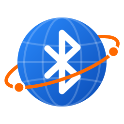
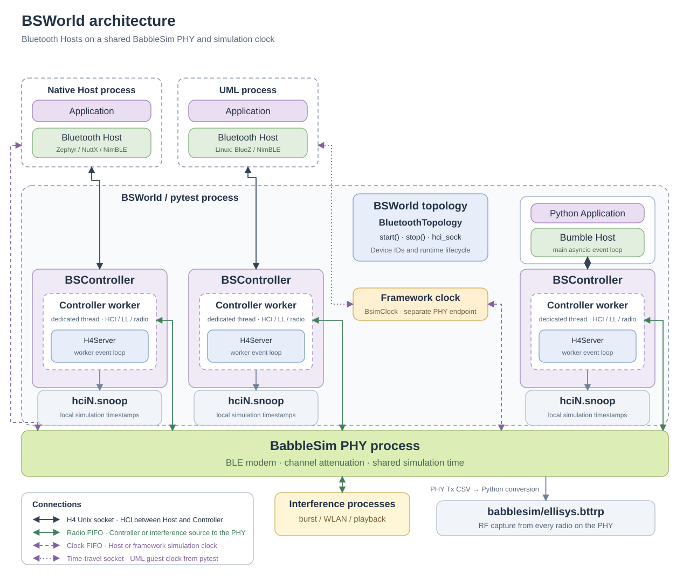

<div align="center">



English | [简体中文](docs/zh-CH/README.md)

[](https://github.com/XiaoMi/bsworld/actions/workflows/ci.yml) [](https://github.com/XiaoMi/bsworld/releases/latest) [](https://pypi.org/project/bscontroller/) [](LICENSE)

</div>

BSWorld tests Bluetooth Hosts and applications on Linux through deterministic simulation. Define the topology and expected behavior in pytest. Hosts connect to BSController over H4 HCI and communicate over a shared BabbleSim radio.

- Test open-source Host stacks without hardware or changes to their source code.
- Run multiple devices on one simulation clock. Run independent scenarios in parallel with pytest-xdist.
- Set path attenuation, inject interference and WLAN activity, or replay recorded radio signals.
- Inspect application logs, HCI BTSnoop captures, per-Controller radio captures, and shared Ellisys traces.

## Quick Start

BSWorld runs on Linux/x86_64.

### Docker

The Docker image ships with BabbleSim, a 32-bit UML kernel, and a Guest root filesystem with the Host executables. Run the integration tests from the repository root on a host with [Docker Engine](https://docs.docker.com/engine/install/ubuntu/).

```sh
sudo docker pull ghcr.io/xiaomi/bsworld-linux:latest
mkdir -p .cache/docker-results
# The image runs as UID/GID 1000.
sudo chown 1000:1000 .cache/docker-results
sudo docker run --rm \
  --security-opt seccomp=docker/uml-seccomp.json \
  --mount "type=bind,src=$PWD/.cache/docker-results,dst=/output" \
  ghcr.io/xiaomi/bsworld-linux:latest
```

The results in `.cache/docker-results` include `pytest.xml`, process logs, HCI captures, and RF traces. For suite selection, image versions, and local builds, see the [Docker guide](docker/README.md).

### Local Linux

Development and tests require Python 3.12 or newer. Install these tools on Ubuntu 24.04.

```sh
sudo apt-get update
sudo apt-get install -y \
  bash ca-certificates curl git repo file make binutils build-essential \
  python3.12 python3.12-dev python3.12-venv python3-pip \
  gcc-multilib g++-multilib coreutils findutils grep sed
```

Clone BSWorld and install it in a virtual environment.

```sh
git clone https://github.com/XiaoMi/bsworld.git
cd bsworld
export BSWORLD_ROOT="$PWD"
python3.12 -m venv .venv
source .venv/bin/activate
python -m pip install -e components/bscontroller -e '.[test]'
```

Run the development checks.

```sh
ruff check .
ruff format --check .
pytest tests/unit -q
```

#### Build and Test

Fetch the BabbleSim revisions pinned in `components/babblesim.xml`.

```sh
mkdir -p "$BSWORLD_ROOT/.cache/babblesim"
cd "$BSWORLD_ROOT/.cache/babblesim"
repo init --standalone-manifest --depth=1 -u "file://$BSWORLD_ROOT/components/babblesim.xml"
repo sync -c --no-tags
```

Set the build paths and compile BabbleSim.

```sh
export BSIM_OUT_PATH="$PWD/build"
export BSIM_COMPONENTS_PATH="$PWD/components"
export BSIM_BUILD_FAIL_ASAP=1
make -j"$(nproc)" everything
```

Run the BabbleSim integration tests from the repository root. In a new shell, activate `.venv` and restore `BSWORLD_ROOT` and `BSIM_OUT_PATH` before running the tests.

```sh
cd "$BSWORLD_ROOT"
pytest tests/integration/babblesim -n auto
```

To run the Host integration suites locally, prepare a 32-bit Guest as described in the [UML test environment guide](tests/integration/uml/README.md).

## Supported Integrations

Each suite runs its Host in a UML Guest and tests it against Bumble on the same simulated radio.

| Guest Host | Coverage |
|---|---|
| [BlueZ](tests/integration/uml/bluez/README.md) | Multi-Guest advertising, scanning, connection and disconnection |
| [Zephyr Bluetooth shell](tests/integration/uml/zephyr/README.md) | Advertising, scanning, GATT, pairing, privacy, link updates, periodic advertising and sync transfer |
| [NuttX BTSak and NimBLE](tests/integration/uml/nuttx/README.md) | Advertising, multi-device scanning, interference recovery, GATT reads, writes and notifications |
| [Apache NimBLE Linux](tests/integration/uml/nimble/README.md) | Discovery and connection |
| [TrouBLE](tests/integration/uml/trouble/README.md) | Battery Service discovery, reads, and notifications in both roles |

## Technical Architecture

Each Host has its own BSController. Bumble uses its Controller's H4 socket directly. UML Guests use Virtio Bluetooth, which BSWorld bridges to the corresponding H4 socket.

The Controllers, the pytest clock, and any configured interference sources share a BabbleSim PHY. Bumble runs in the pytest event loop. Each UML Guest runs in a separate process and receives simulation time from that loop through its own time-travel socket. A topology can run several Guests together.

<div align="center"><br><em>Figure 1: BSWorld architecture</em><br><br></div>

To set per-Controller options such as device address, buffer sizes, and Bluetooth version, see [BSController configuration](docs/controllers.md).

Open `hciN.snoop` and `radioN.pcapng` in Wireshark to inspect a Controller's HCI traffic and radio activity. The shared `babblesim/ellisys.bttrp` collects BSController transmissions for Ellisys. For capture scope and file locations, see [Logs, traces, and captures](docs/artifacts.md).

### Discrete-Time Scheduling

| Time base | Meaning |
|---|---|
| **Simulation time** | Advances when all PHY participants synchronize. It governs protocol timers, packet timing, RF events, asyncio waits, and test timeouts. |
| **Wall-clock time** | Measures test duration on the host and varies with CPU load and Linux scheduling. |

After startup, standard `asyncio` waits and timeouts use simulation time. See [Async waiting and simulation time](docs/writing-tests.md#async-waiting-and-simulation-time) for examples.

Repeatability assumes identical binaries and inputs and controlled random sources. External networks, wall-clock-driven services, and other unadapted Host I/O can still introduce nondeterminism.

## Documentation

- [Write tests and configure RF scenarios](docs/writing-tests.md)
- [Allocate and configure BSControllers](docs/controllers.md)
- [Find logs, traces, and captures](docs/artifacts.md)
- [Run unit tests, lint checks, and coverage](docs/development.md)
- [Build or run the Docker test image](docker/README.md)

## Community

- [Contributing](CONTRIBUTING.md)
- [Code of Conduct](CODE_OF_CONDUCT.md)
- [Security Policy](SECURITY.md)

## License

BSWorld is licensed under the [Apache License 2.0](LICENSE). For third-party licenses, see [Third-Party Notices](THIRD_PARTY_NOTICES.md).
