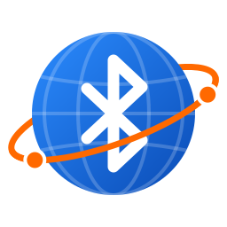
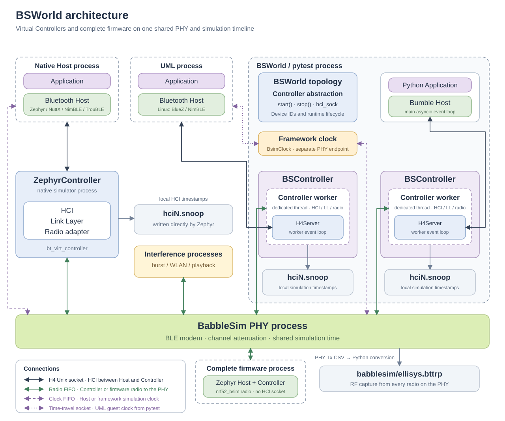

<div align="center">



English | [简体中文](docs/zh-CH/README.md)

[](https://github.com/XiaoMi/bsworld/actions/workflows/ci.yml) [](https://github.com/XiaoMi/bsworld/releases/latest) [](https://pypi.org/project/bscontroller/) [](LICENSE)

</div>

BSWorld is a deterministic simulation framework for testing Bluetooth Hosts and Applications on Linux. A pytest scenario defines the device topology and expected behavior; BSWorld runs the participants on a shared BabbleSim radio and simulation clock, then archives logs and protocol traces.

Use BSWorld to:

- Test open-source Host stacks such as Zephyr, NuttX, BlueZ, NimBLE, Bumble, and TrouBLE without modifying their source code.
- Run without hardware: Hosts connect over standard H4 HCI to virtual Controllers, or complete firmware joins the PHY with its own Controller and radio.
- Keep Application logs, HCI BTSnoop captures, PHY logs, and Ellisys traces for debugging failures.
- Simulate many devices in one scenario. Repeated runs of the same scenario produce consistent logs and timing, regardless of host load or scheduling.
- Share one discrete simulation clock across all devices. Scenarios are isolated and run in parallel with pytest-xdist, up to 100 times faster than real time.
- Inject attenuation, interference, WLAN activity, and recorded radio signals.

## Quick Start

BSWorld runs on Linux/x86_64. Develop in a [local Linux](#local-linux) environment, and use the published Docker images to run and verify the tests. Each platform's image holds BSWorld and that platform's compiled executables as CI tested them, without toolchains or firmware sources; the [Docker guide](docker/README.md) lists them.

### Docker

Install [Docker Engine](https://docs.docker.com/engine/install/ubuntu/), then run an image's integration tests, taking the Zephyr image as an example:

```sh
sudo docker pull ghcr.io/xiaomi/bsworld-zephyr:latest
mkdir -p .cache/docker-results
# The published images run as UID/GID 1000.
sudo chown 1000:1000 .cache/docker-results
sudo docker run --rm \
  --mount "type=bind,src=$PWD/.cache/docker-results,dst=/output" \
  ghcr.io/xiaomi/bsworld-zephyr:latest
```

Results are written to `.cache/docker-results`, including `pytest.xml`, process logs, HCI captures, and RF traces. See the [Docker guide](docker/README.md) for the NuttX, TrouBLE and Linux images, to run a selected suite, test the current checkout, choose an image version, or build an image.

### Local Linux

A local environment builds the firmware and runs the tests with your own tools, so changes rebuild incrementally.

Development and test commands require Python 3.12 or newer. On Ubuntu 24.04, install the required tools:

```sh
sudo apt-get update
sudo apt-get install -y \
  bash ca-certificates curl git repo file make binutils build-essential \
  python3.12 python3.12-dev python3.12-venv python3-pip \
  gcc-multilib g++-multilib coreutils findutils grep sed
```

Clone and install BSWorld:

```sh
git clone https://github.com/XiaoMi/bsworld.git
cd bsworld
export BSWORLD_ROOT="$PWD"
python3.12 -m venv .venv
source .venv/bin/activate
python -m pip install -e components/bscontroller -e '.[test]'
```

Run the development checks:

```sh
ruff check .
ruff format --check .
pytest tests/unit tests/integration/support -q
```

#### Build and Test

Fetch the BabbleSim revisions selected by `components/babblesim.xml`:

```sh
mkdir -p "$BSWORLD_ROOT/.cache/babblesim"
cd "$BSWORLD_ROOT/.cache/babblesim"
repo init --standalone-manifest --depth=1 -u "file://$BSWORLD_ROOT/components/babblesim.xml"
repo sync -c --no-tags
```

Set the output paths and build every component:

```sh
export BSIM_OUT_PATH="$PWD/build"
export BSIM_COMPONENTS_PATH="$PWD/components"
export BSIM_BUILD_FAIL_ASAP=1
make -j"$(nproc)" everything
```

Export `BSWORLD_ROOT`, `BSIM_OUT_PATH` and `BSIM_COMPONENTS_PATH` again in every new shell that builds or runs tests; without `BSIM_OUT_PATH`, the integration tests stop with a setup error.

Run the Bumble and BabbleSim scenarios, which need no other binaries:

```sh
cd "$BSWORLD_ROOT"
pytest tests/integration/bumble tests/integration/babblesim -n auto
```

The other suites run a platform's executables. Build them with the guides in [Supported Integrations](#supported-integrations), which name the variable to export for each executable.

## Supported Integrations

| Environment | Validated behavior | Guide |
|---|---|---|
| Zephyr Bluetooth shell | Advertising and scanning, interference and recovery, connections and GATT, LL procedures, pairing and privacy, periodic advertising; complete firmware against Host-only shells on either Controller and against Bumble | [Zephyr tests](tests/integration/zephyr/README.md) |
| Bumble Python Host | Advertising, scanning, connections, periodic advertising and synchronization | [Bumble tests](tests/integration/bumble/README.md) |
| Linux and BlueZ under User Mode Linux | Controller setup, advertising, scanning, connection and disconnection through the Linux Bluetooth subsystem | [BlueZ tests](tests/integration/uml/bluez/README.md) |
| TrouBLE Rust Host | Advertising, connection, Battery Service discovery, reads and notifications | [TrouBLE tests](tests/integration/trouble/README.md) |
| NuttX BTSak | Advertising, scanning, multiple advertisers, interference and recovery | [BTSak tests](tests/integration/nuttx/btsak/README.md) |
| Apache NimBLE | Discovery, connection, GATT and subscription on NuttX; discovery and connection under User Mode Linux | [NuttX tests](tests/integration/nuttx/nimble/README.md) · [UML tests](tests/integration/uml/nimble/README.md) |

## Technical Architecture

BSWorld keeps each Application and Host stack on its native interface. Every Host connects through standard HCI to an independent Zephyr Controller process or Python BSController worker. Complete Zephyr firmware includes its own Controller and radio and joins the PHY directly; see [Complete firmware](docs/writing-tests.md#complete-firmware). All Controllers, complete firmware and interference sources share the BabbleSim PHY and simulation clock. Native Hosts also join the PHY's clock, Bumble runs on the pytest event loop, and a User Mode Linux guest receives its clock from that loop through UML time-travel.

<div align="center"><br><em>Figure 1: BSWorld architecture</em><br><br></div>

The virtual Controllers implement HCI commands, events, ACL data, Link Layer procedures, and radio transmission and reception. A topology can mix RTOS, Python, User Mode Linux and complete Zephyr participants with either Controller implementation. See [Virtual Controllers](docs/controllers.md) to choose and configure them.

HCI traffic is saved as `hciN.snoop` for Wireshark or another BTSnoop-capable tool. Radio traffic is saved as `babblesim/ellisys.bttrp` for Ellisys. See [Logs, traces, and captures](docs/artifacts.md) for locations and a recommended investigation order.

### Discrete-Time Scheduling

| Time base | Meaning |
|---|---|
| **Simulation time** | Defines protocol timers, packet timing, RF events, asyncio waits, and test timeouts. It advances only after all participants synchronize. |
| **Wall-clock time** | Measures how long the test takes on the host. CPU load and Linux scheduling affect this duration but not protocol timing. |

BSWorld registers Applications, Controllers, interference devices, and pytest in the same simulation. A shared synchronization barrier keeps them on one timeline, so a protocol interval such as `T_IFS = 150 μs` remains 150 μs regardless of host load. After topology startup, standard `asyncio` waits and timeouts use simulation time; see [Async waiting and simulation time](docs/writing-tests.md#async-waiting-and-simulation-time).

Repeatability assumes identical binaries and inputs and controlled random sources. External networks, wall-clock-driven services, and other unadapted Host I/O can still introduce nondeterminism.

## Documentation

- [Writing tests and RF scenarios](docs/writing-tests.md): define topologies, integrate Applications, wait with asyncio, and configure RF conditions.
- [Virtual Controllers](docs/controllers.md): choose between the Zephyr and Python Controllers, run a scenario against both, and configure BSController.
- [Logs, traces, and captures](docs/artifacts.md): locate and analyze test artifacts.
- [Development checks](docs/development.md): run unit tests, lint, and coverage.
- [Docker guide](docker/README.md): run published images, select suites, and build local images.

## Community

- [Contributing](CONTRIBUTING.md)
- [Code of Conduct](CODE_OF_CONDUCT.md)
- [Security Policy](SECURITY.md)

## License

BSWorld is licensed under the [Apache License 2.0](LICENSE). Third-party components retain their own licenses; see [Third-Party Notices](THIRD_PARTY_NOTICES.md).
