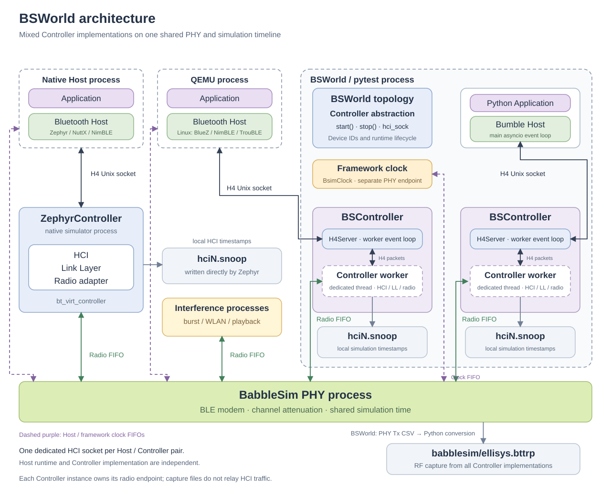

# BSWorld

[English](README.md) | [简体中文](docs/zh-CH/README.md)

BSWorld is a deterministic simulation framework for testing Bluetooth Hosts and Applications on Linux. A pytest scenario defines the device topology and expected behavior; BSWorld runs the participants on a shared BabbleSim radio and simulation clock, then archives logs and protocol traces.

Use BSWorld to:

- Test advertising, scanning, connections, GATT, periodic advertising, Mesh, and multi-device behavior with real Host stacks.
- Reproduce protocol timing and RF behavior independently of Linux scheduling jitter.
- Inject attenuation, interference, WLAN activity, and recorded radio signals.
- Run isolated scenarios in parallel with pytest-xdist.
- Debug failures with Application logs, HCI BTSnoop captures, PHY logs, and Ellisys traces.

## Quick Start

BSWorld runs on Linux/x86_64. The published Docker image includes Python, BSWorld, and the firmware required by the integration tests.

### Docker (Recommended)

Install [Docker Engine](https://docs.docker.com/engine/install/ubuntu/), then run the packaged integration tests:

```sh
sudo docker pull ghcr.io/xiaomi/bsworld:latest
mkdir -p .cache/docker-results
# The published image runs as UID/GID 1000.
sudo chown 1000:1000 .cache/docker-results
sudo docker run --rm \
  -e PYTHONPATH=/workspace \
  --mount "type=bind,src=$PWD/.cache/docker-results,dst=/output" \
  ghcr.io/xiaomi/bsworld:latest
```

Results are written to `.cache/docker-results`, including `pytest.xml`, process logs, HCI captures, and RF traces. See the [Docker guide](docker/README.md) to run a selected suite, test the current checkout, choose an image version, or build an image.

### Local Linux

Development and test commands require Python 3.12 or newer. On Ubuntu 24.04, install the required tools:

```sh
sudo apt-get update
sudo apt-get install -y \
  bash ca-certificates curl git repo file make binutils build-essential \
  python3.12 python3.12-dev python3.12-venv python3-pip \
  gcc-multilib g++-multilib coreutils findutils grep sed
```

Clone and install BSWorld:

```sh
git clone https://github.com/XiaoMi/bsworld.git
cd bsworld
export BSWORLD_ROOT="$PWD"
python3.12 -m venv .venv
source .venv/bin/activate
python -m pip install -e .
```

Run the development checks:

```sh
ruff check src tests
pytest tests/unit -q
```

#### Build and Test

Fetch the BabbleSim revisions selected by `components/babblesim.xml`:

```sh
mkdir -p "$BSWORLD_ROOT/.cache/babblesim"
cd "$BSWORLD_ROOT/.cache/babblesim"
repo init --standalone-manifest --depth=1 -u "file://$BSWORLD_ROOT/components/babblesim.xml"
repo sync -c --no-tags
```

Set the output paths and build every component:

```sh
export BSIM_OUT_PATH="$PWD/build"
export BSIM_COMPONENTS_PATH="$PWD/components"
export BSIM_BUILD_FAIL_ASAP=1
make -j"$(nproc)" everything
```

Build the required Host and Controller binaries using the guides for the [Zephyr Controller](docs/controllers.md#building-the-zephyr-controller), [Zephyr shell](tests/integration/zephyr/shell/README.md), [NuttX](tests/integration/nuttx/README.md), or [QEMU / Buildroot](tests/integration/qemu/README.md). Then run the integration tests:

```sh
cd "$BSWORLD_ROOT"
source .venv/bin/activate
pytest tests/integration -n auto
```

### Test Controller Variants

Integration scenarios run with both the Zephyr Controller (`[zephyr]`) and Python BSController (`[bscontroller]`) by default; see [Virtual Controllers](docs/controllers.md). Select one implementation with its pytest parameter ID:

```sh
pytest tests/integration -n auto -v -k '[zephyr]'
pytest tests/integration -n auto -v -k '[bscontroller]'
```

## Supported Integrations

| Environment | Validated behavior | Guide |
|---|---|---|
| Zephyr Bluetooth shell | Advertising and scanning, interference and recovery, connections and GATT, LL procedures, pairing and privacy across Controller pairings, periodic advertising, Mesh provisioning and configuration | [Zephyr tests](tests/integration/zephyr/shell/README.md) |
| Bumble Python Host | Advertising, scanning, connections, periodic advertising and synchronization | [Bumble tests](tests/integration/bumble/README.md) |
| Linux and BlueZ under QEMU | Controller setup, advertising, scanning, connection and disconnection through the Linux Bluetooth subsystem | [BlueZ tests](tests/integration/qemu/bluez/README.md) |
| TrouBLE Rust Host | Advertising, connection, Battery Service discovery, reads and notifications | [TrouBLE tests](tests/integration/trouble/README.md) |
| NuttX BTSak | Advertising, scanning, multiple advertisers, interference and recovery | [BTSak tests](tests/integration/nuttx/btsak/README.md) |
| Apache NimBLE | Discovery, connection, GATT and subscription on NuttX; discovery and connection under QEMU | [NuttX tests](tests/integration/nuttx/nimble/README.md) · [QEMU tests](tests/integration/qemu/nimble/README.md) |

## Technical Architecture

BSWorld keeps each Application and Host stack on its native interface. Every Host connects through standard HCI to an independent Zephyr Controller process or Python BSController worker. All Controllers and interference sources share the BabbleSim PHY and simulation clock.

<div align="center"><br><em>Figure 1: BSWorld architecture</em><br><br></div>

The virtual Controllers implement HCI commands, events, ACL data, Link Layer procedures, and radio transmission and reception. A topology can mix RTOS, Python, and QEMU-based Linux participants with either Controller implementation. See [Virtual Controllers](docs/controllers.md) to choose and configure them.

HCI traffic is saved as `hciN.snoop` for Wireshark or another BTSnoop-capable tool. Radio traffic is saved as `babblesim/ellisys.bttrp` for Ellisys. See [Logs, traces, and captures](docs/artifacts.md) for locations and a recommended investigation order.

### Discrete-Time Scheduling

| Time base | Meaning |
|---|---|
| **Simulation time** | Defines protocol timers, packet timing, RF events, asyncio waits, and test timeouts. It advances only after all participants synchronize. |
| **Wall-clock time** | Measures how long the test takes on the host. CPU load and Linux scheduling affect this duration but not protocol timing. |

BSWorld registers Applications, Controllers, interference devices, and pytest in the same simulation. A shared synchronization barrier keeps them on one timeline, so a protocol interval such as `T_IFS = 150 μs` remains 150 μs regardless of host load. After topology startup, standard `asyncio` waits and timeouts use simulation time; see [Async waiting and simulation time](docs/writing-tests.md#async-waiting-and-simulation-time).

Repeatability assumes identical binaries and inputs and controlled random sources. External networks, wall-clock-driven services, and other unadapted Host I/O can still introduce nondeterminism.

## Documentation

- [Writing tests and RF scenarios](docs/writing-tests.md): define topologies, integrate Applications, wait with asyncio, and configure RF conditions.
- [Virtual Controllers](docs/controllers.md): choose between the Zephyr and Python Controllers, run a scenario against both, and configure BSController.
- [Logs, traces, and captures](docs/artifacts.md): locate and analyze test artifacts.
- [Development checks](docs/development.md): run unit tests, lint, and coverage.
- [Docker guide](docker/README.md): run published images, select suites, and build local images.

## Community

- [Contributing](CONTRIBUTING.md)
- [Code of Conduct](CODE_OF_CONDUCT.md)
- [Security Policy](SECURITY.md)

## License

BSWorld is licensed under the [Apache License 2.0](LICENSE). Third-party components retain their own licenses; see [Third-Party Notices](THIRD_PARTY_NOTICES.md).
