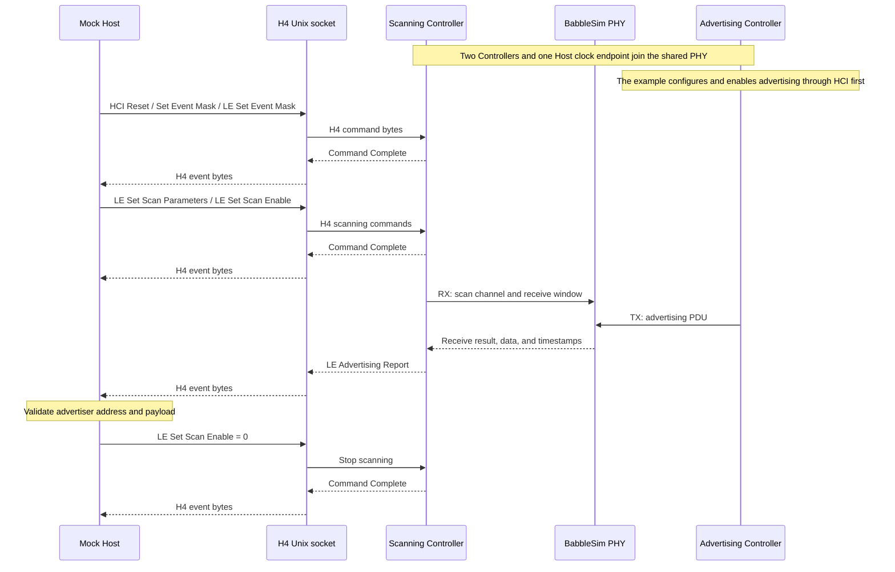

# BSController

English | [中文](README.zh-CN.md)

BSController is a Python Bluetooth LE Controller that can be installed, run, and published independently. Its import package and command-line entry point are both named `bscontroller`. It exposes an H4 HCI byte interface to the Host, executes LE link-layer procedures, and uses a BabbleSim PHY for radio transmission, reception, and discrete-time synchronization.

Supported features include legacy advertising, active and passive scanning, extended advertising, periodic advertising and synchronization, ACL connections, link-layer encryption, data-length negotiation, channel selection, and PHY updates across LE 1M, LE 2M, and LE Coded PHYs. Privacy, ISO, PAwR, and Bluetooth Classic are not implemented.

## Installation and execution

The module requires Python 3.11 or newer and [BabbleSim](https://babblesim.github.io/) for RF simulation, running on Linux. The following instructions use Ubuntu 24.04 x86_64. Install the build tools first:

```sh
sudo apt-get update
sudo apt-get install -y git repo build-essential gcc-multilib g++-multilib python3-venv
```

Follow the [official BabbleSim fetching instructions](https://babblesim.github.io/fetching.html) to download the sources, then build the PHY, modem, and channel needed by this module:

```sh
mkdir -p "$HOME/bsim"
cd "$HOME/bsim"
repo init -u https://github.com/BabbleSim/manifest.git -m everything.xml -b master
repo sync

export BSIM_OUT_PATH="$PWD/build"
export BSIM_COMPONENTS_PATH="$PWD/components"

make -j"$(nproc)" ext_2G4_phy_v1 ext_2G4_modem_BLE_simple ext_2G4_channel_multiatt
```

Build outputs are placed in `$BSIM_OUT_PATH/bin/` and `$BSIM_OUT_PATH/lib/`. Retain these exports when running BSController; the CLI, examples, and RF tests use `BSIM_OUT_PATH` directly. See the [official BabbleSim build instructions](https://babblesim.github.io/building.html) for more options.

After building BabbleSim, return to this module's source root and install the Python package:

```sh
python3 -m venv .venv
source .venv/bin/activate
python -m pip install .
bscontroller --help
```

## Technical architecture

Each Controller contains HCI, Link Layer, and radio adaptation; its runtime owns worker threads, simulation clocks, and process lifecycles. Every instance owns its worker thread, event loop, device identity, and FIFO radio endpoint. Multiple Controllers connect to the same BabbleSim PHY and interact through shared radio channels and a common simulation timeline.

<div align="center"><br><em>Figure 1: Controller protocol architecture and shared PHY</em></div>

| Layer | Main implementation | Responsibility |
| --- | --- | --- |
| HCI interface | `hci/transport.py`, `hci/packets.py`, `hci/controller.py`, `hci/snoop.py` | H4 framing, HCI serialization, command dispatch, events, ACL data, and BTSnoop capture |
| HCI commands and state | `hci/backend.py`, `hci/le.py`, `hci/events.py` | HCI validation, capabilities, advertising/scanning/connection state, and event conversion |
| LE radio procedures | `linklayer/link.py`, `linklayer/primary.py`, `linklayer/extended.py`, `linklayer/periodic.py`, `linklayer/connection.py` | Advertising and scan windows, periodic synchronization, connection events, and on-air PDUs |
| LL control procedures | `linklayer/control.py`, `linklayer/data_length.py`, `linklayer/encryption.py` | Connection control, data-length negotiation, encryption, and related state machines |
| Radio abstraction and scheduling | `radio/base.py`, `linklayer/scheduler.py` | PHY parameters, receive results, reservation conflicts, and available radio slots |
| Runtime and PHY adaptation | `runtime/worker.py`, `runtime/session.py`, `runtime/event_loop.py`, `radio/babblesim.py`, `runtime/phy.py` | Thread isolation, discrete event loops, FIFO communication, session and PHY process lifecycle |

Paths in the table are relative to `src/bscontroller/`. The Controller layer owns HCI decoding and responses. Radio procedures access transmission and reception through the `Radio` protocol, with BabbleSim FIFO details contained in its adapter. `linklayer/scheduler.py` only calculates reservations, priority conflicts, and complete available slots; it does not create tasks or advance clocks.

The source responsibilities follow Bluetooth Core 6.3. See the [per-file architecture mapping](docs/architecture.md) for references, dependency boundaries, and the distinction between protocol requirements and simulator policy. Mock Host code lives in `examples/`; Host payload builders live in tests.

## Running examples

[examples/advertise_scan.py](examples/advertise_scan.py) exposes a scanning Controller through a standard H4 HCI Unix socket and implements a Mock Host that only exchanges HCI bytes over that socket. A second Controller transmits advertisements through the shared PHY, providing simulated RF input.

```sh
python examples/advertise_scan.py
```



The example exercises the Host's H4 transport boundary, HCI command processing, and PHY advertising reception path. See [examples/README.md](examples/README.md) for details.

Expose H4 HCI to an external Host:

```sh
bscontroller serve --hci-socket /tmp/radio.sock --btsnoop-file /tmp/hci.snoop
```

Use `hci_snoop_file=Path(...)` when constructing `RadioController`, or `--btsnoop-file` with the CLI, to write a BTSnoop v1 H4 capture. The worker records complete HCI packets with its local simulation timestamps before handing output to the Host loop. Records are written without user-space buffering; capture does not advance simulation time. BSWorld supplies this path automatically.

The Host exchanges an H4 HCI byte stream over the Unix socket. The service accepts one Host and exits when it disconnects; the socket path must be unused. See `bscontroller serve --help` for more options.

## Threads, clocks, and resource ownership

Create `RadioController` inside the Host's running event loop. On startup, it constructs and runs its Controller in a dedicated thread. Startup returns after FIFO connection so the session can start other PHY participants. Host input enters a thread-safe queue as immutable H4 packets and is consumed after the initial PHY grant and between radio steps; enqueuing input does not interrupt an outstanding PHY request. Controller output returns to the Host event loop through `call_soon_threadsafe`. The Host and worker do not share mutable protocol state.

RF time uses integer microseconds. Each worker maintains its own clock endpoint and synchronizes with the common simulation timeline through PHY requests and responses. A standalone Host can use an additional clock endpoint, with a PHY device identity distinct from every Controller.

Once existing I/O and ready work have been handled, `RadioEventLoop` converts idle waits into simulation-time advances bounded by the next timer and maximum step. The Controller event loop also drains current ready work before admitting a PHY request and runs software timers preceding the RF start first. The PHY coordinates radio events from multiple Controllers on the common simulation timeline.

| Object | Resources it manages |
| --- | --- |
| `RadioController` | One worker thread, Controller event loop, and radio FIFO endpoint |
| `RadioSession` | Worker startup and shutdown, plus an optional standalone Host clock connection and loop binding |
| `H4Server` | Unix socket, one Host connection, H4 framing, and a bounded output queue |
| `PhyProcess` | BabbleSim PHY subprocess, logs, and simulation directory cleanup |

`RadioSession` connects to an already running PHY; it does not start that process. With `clock_dev_id`, the Host must use `RadioEventLoop`. Without it, the caller supplies a synchronized clock and event loop and owns device identities, startup barriers, and time binding. Stop workers before closing the Host clock and PHY. The CLI and example already combine these lifecycles.

## Python integration

Public exports include `RadioController`, `RadioSession`, `RadioEventLoop`, `Radio`, `Phy`, `Received`, and `hci`. For a direct connection, send complete H4 packets with `controller.on_packet(packet)` and register an output sink with `controller.set_packet_sink(sink)` before starting the worker. The sink must implement `on_packet(packet: bytes)`.

For an external Host, pass `hci_socket` to `RadioController`. The worker owns socket reads, H4 parsing, and replies in its Controller thread. Startup returns once the socket is listening; commands wait until the worker has received its initial PHY grant at time zero and bound its clock. Socket mode does not use the cross-thread packet queue or HCI polling timer.

This example joins a PHY already started by the caller. The PHY must use the same `sim_id` and have two devices: identity `0` for the Controller and `1` for the Host clock.

```python
import asyncio
from pathlib import Path

from bscontroller import RadioController, RadioEventLoop, RadioSession


async def main():
    controller = RadioController(
        "controller", "F0:F1:F2:F3:F4:01", hci_socket=Path("/tmp/radio.sock")
    )
    async with RadioSession("example", [(0, controller)], clock_dev_id=1):
        await controller.terminated


with asyncio.Runner(loop_factory=RadioEventLoop) as runner:
    runner.run(main())
```

## Layout and verification

```text
.
├── pyproject.toml
├── src/bscontroller/
│   ├── __init__.py          # Public API
│   ├── hci/                # HCI codecs, command handling, events, and H4 transport
│   ├── linklayer/          # On-air PDUs, advertising, scanning, and LL procedures
│   ├── radio/              # Radio interface and BabbleSim adapter
│   ├── runtime/            # Worker threads, simulation clocks, and PHY processes
│   └── cli.py              # H4 service entry point
├── examples/
│   └── advertise_scan.py   # H4 Controller and scanning Mock Host
└── tests/
    ├── unit/               # Mirrors source directories and module names
    │   ├── hci/
    │   ├── linklayer/
    │   ├── radio/
    │   └── runtime/
    ├── qualification/      # Protocol cases, lower testers, and case registration
    │   ├── hci/
    │   └── ll/
    └── support.py          # Shared wire values and payload builders
```

```sh
python -m pip install -e '.[test]'
python -m pytest tests/unit -n auto --dist worksteal -q
python -m pytest tests/qualification -n auto --dist worksteal -v -rs
python -m build
```

The protocol suite contains 501 selected HCI/LL cases, retaining distinct `PASS`, `PARTIAL`, source-conflict skips, and applicability skips. Timing-limited cases use their documented integer-microsecond approximation. These results are not a Bluetooth qualification claim. See [tests/README.md](tests/README.md) for test scope and execution details.

Build artifacts are written to `dist/`. The source distribution includes the runtime, examples, and unit and protocol tests; the wheel contains the runtime and required license notices. See [LICENSE](LICENSE) and [NOTICE](NOTICE) for licensing and third-party attribution.
