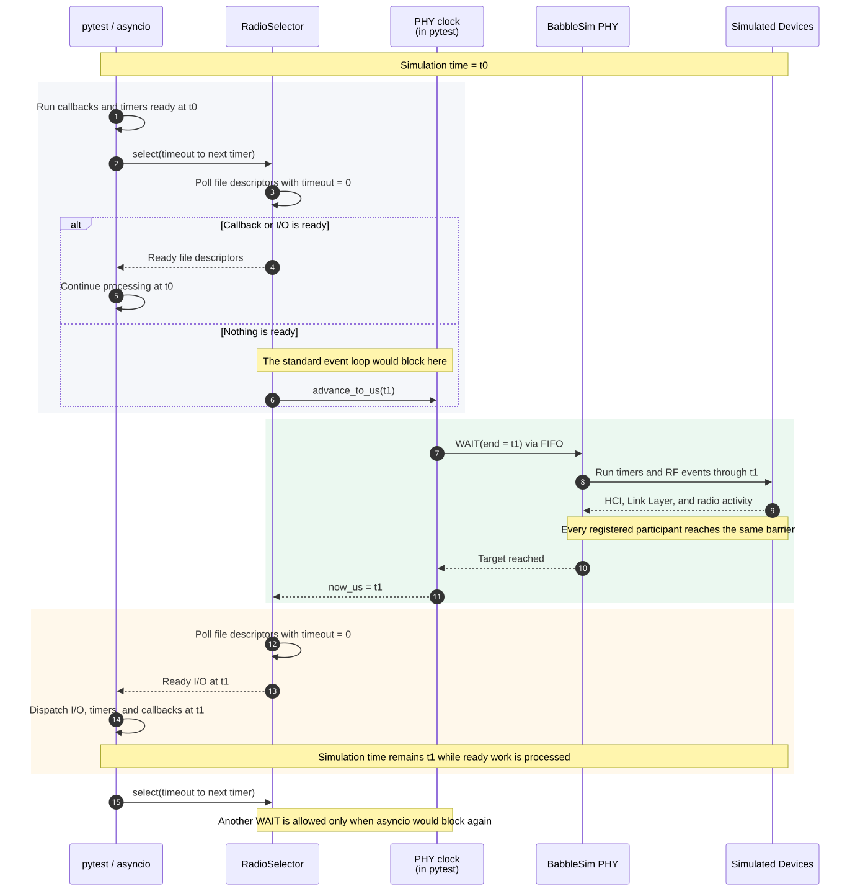

# Writing Tests

[English](writing-tests.md) | [简体中文](zh-CH/writing-tests.md)

The repository [README](../README.md#technical-architecture) introduces the Virtual Controller and discrete-time scheduler. This guide follows the practical test-authoring workflow: declare a topology, integrate Applications, drive and await behavior with asyncio, configure RF conditions, and verify the expected Bluetooth LE result.

## Quick Index

- [Test Lifecycle](#test-lifecycle)
- [Adding Controllers](#adding-controllers)
- [Async Waiting and Simulation Time](#async-waiting-and-simulation-time)
- [Running Hosts in UML](#running-hosts-in-uml)
- [Process Shell Commands](#process-shell-commands)
- [RF Conditions and Interference](#rf-conditions-and-interference)
- [Topology as a pytest Test](#topology-as-a-pytest-test)

## Test Lifecycle

The `topo` fixture gives each test a `BluetoothTopology`.

1. Register one Controller per Host with `topo.add_controller()` and configure RF conditions.
2. Call `await topo.start()` to start the PHY, Controllers, interference sources and simulation clock.
3. Boot UML Guests and verify behavior through their consoles. Python Hosts such as Bumble connect directly to their HCI sockets from the test's asyncio event loop.
4. Teardown stops the Guests, Controllers and PHY and saves the logs and captures.

Every test receives its own simulation ID, Unix socket directory, and log directory. Virtual tests can therefore run concurrently without sharing Controller state, RF state, or output files.

## Adding Controllers

Each Host gets its own virtual Controller from `topo.add_controller()` and connects to its `hci_sock` after `topo.start()`:

```python
ctl = topo.add_controller(public_address="F0:F1:F2:F3:F4:01")
await topo.start()
# Connect the Host to ctl.hci_sock.
```

See [BSController configuration](controllers.md) for the available settings.

## Async Waiting and Simulation Time

BSWorld preserves the standard asyncio programming model. Tests do not need simulation-specific task, I/O, sleep, or timeout APIs. Pytest runs on a `BsimEventLoop`, which retains asyncio's tasks, futures, queues, events, streams, and sockets; only its source of time and blocking behavior change after simulation startup.

The event loop initially follows wall-clock time while the test prepares its topology. Once `await topo.start()` has launched and registered every BabbleSim participant, BSWorld binds the BabbleSim clock client to the loop. From that point, `loop.time()` advances with simulation time, and APIs such as `asyncio.sleep()` and `asyncio.wait_for()` use the same clock. A `timeout=30` therefore allows 30 simulated seconds, not 30 seconds of wall-clock time:

```python
import asyncio

await topo.start()

await dev.wait_log("ready", timeout=30)
await asyncio.sleep(0.2)
result = await asyncio.wait_for(operation(), timeout=5)
```

Simulation time only advances once every callback and I/O event at the current timestamp has been processed, so a test observes all work scheduled for one instant before the clock moves. Figure 1 shows one such step.

<div align="center"><br><em>Figure 1: One deterministic simulation-time step</em><br><br></div>

`UmlGuest.wait_log()` uses the same asynchronous clock, so its `timeout` is also measured in simulation time. It applies a regular expression to complete buffered and newly arriving lines in arrival order. A fragment is not eligible until its terminating newline arrives, and a later call does not revisit lines that have already been scanned. Write consecutive log assertions in the expected event order.

> [!WARNING]
> Do not call blocking functions such as `time.sleep()` inside an async test because they block the event loop thread. Prefer asynchronous APIs; host-side blocking work that does not participate in protocol timing can be moved to `asyncio.to_thread()` when unavoidable.

## Running Hosts in UML

Add one Controller per Guest before starting the topology. After startup, open each Guest with `bsworld.uml.UmlGuest`. It runs the supplied kernel with a read-only root filesystem and connects the Controller's H4 socket to `/dev/ttyS0`. The `init` path is relative to the Guest root.

```python
from bsworld.uml import UmlGuest

controller = topo.add_controller(log_subdir="uml/host")
await topo.start()

with UmlGuest(
    topo,
    controller,
    kernel=kernel,
    rootfs=rootfs,
    init="/init",
    label="host",
    log_subdir="uml/host",
    getrandom_library=seed_library,
) as guest:
    await guest.wait_log(r"^BSWORLD_UML_READY$")
    await guest.shell.run("btattach -B /dev/ttyS0 -P h4 &")
    await guest.wait_log(r"Device index 0 attached")
```

Use distinct labels and Controllers for multiple Guests in one test. Each Guest has a separate console and time-travel socket. They share the topology's clock and use no PHY device IDs of their own. See the [UML test environment](../tests/integration/uml/README.md) for the kernel, root filesystem, and seed library.

## Process Shell Commands

Wait for the Guest console before sending commands.

```python
await dev.shell.run("...")
await dev.wait_log(r"...", timeout=5)
```

Replace the placeholders with a command and its expected output from the platform guide. `shell.run()` writes one line to standard input; it does not wait for command completion. Use `wait_log()` or another observable condition to verify the result.

## RF Conditions and Interference

Configure RF conditions before `await topo.start()`; the PHY configuration and participant set are immutable after startup. Attenuation and interference sources share one BabbleSim PHY with all Virtual Controllers. The PHY uses the `BLE_simple` modem by default, so RSSI, SNR, and path attenuation affect packet reception.

### Channel Attenuation

```python
topo.set_channel_attenuation(
    default_db=70.0,
    extra_db=0.0,
)
```

| Parameter | Default | Meaning |
|---|---|---|
| `default_db` | `60.0` | Path loss for every directed `tx -> rx` path not covered by a static or timed override. |
| `extra_db` | `0.0` | Extra attenuation added on top of every path. |
| `matrix_file` | `None` | Path to a raw `multiatt` matrix file. Mutually exclusive with generated paths. |
| `static_paths` | `[]` | List of fixed per-path attenuation values. |
| `timed_paths` | `[]` | List of time-varying per-path attenuation curves. |

### Per-Path Attenuation

Here, `peripheral` and `central` are devices already registered with the topology.

```python
from bsworld.interference import StaticAttenuation, TimedAttenuation

topo.set_channel_attenuation(
    default_db=50.0,
    static_paths=[
        StaticAttenuation(
            tx=peripheral,
            rx=central,
            attenuation_db=55.0,
        ),
    ],
    timed_paths=[
        TimedAttenuation(
            tx=central,
            rx=peripheral,
            times_us=[0, 10_000_000, 20_000_000],
            attenuation_db=[50.0, 80.0, 50.0],
        ),
    ],
)
```

Paths are directional. Configure both `tx -> rx` and `rx -> tx` when the two directions require distinct loss values. A `TimedAttenuation` curve pairs each timestamp with one attenuation value and linearly interpolates between adjacent points.

`tx` and `rx` accept registered `BSController` objects, `InterferenceRef` objects from `add_*_interference()`, and raw BabbleSim device IDs.

### Burst Interference

```python
jammer = topo.add_burst_interference(
    center_freq_mhz=2402.0,
    power_dbm=10.0,
    interf_type="CW",
    windows=[],
    rand_seed=None,
)
```

`windows=[]` keeps the source active for the full simulation; use `[(start_us, end_us)]` for bounded windows. The returned `InterferenceRef` can be used as the `tx` endpoint of `StaticAttenuation` or `TimedAttenuation` to control loss from the source to a particular receiver.

### WLAN Activity Model

```python
topo.add_wlan_interference(
    channel=6,
    power_dbm=20.0,
    config_set="VideoConf",
)
```

Specify the frequency with exactly one of `channel=1..14` and `center_freq_mhz=<MHz>`. `config_set` selects a traffic profile such as `VoIP`, `VideoConf`, `FileDownload`, `100`, `50`, `25`, `10`, or `5`.

### Playback Interference

```python
topo.add_playback_interference("path/to/recording")
```

The input path is a prefix. BabbleSim expects `.Tx.csv`, `.Rx.csv`, `.RSSI.csv`, and `.CCA.csv` files with that prefix.

### Parameter Constraints

BSWorld validates RF inputs before spawning BabbleSim processes:

| Area | Parameter | Accepted range |
|---|---|---|
| Burst / WLAN | `center_freq_mhz` | `> 2273.0` and `< 2527.0` MHz. The API expects absolute MHz; common Bluetooth LE advertising channels are 2402, 2426, and 2480 MHz. |
| Burst / WLAN | `power_dbm` | `-128.0 .. 127.0` dBm. |
| Burst / WLAN | `windows` | At most 256 windows. Each `(start_us, end_us)` must use integer microseconds, `start_us > 0`, `end_us > start_us`, and windows must be strictly ordered and non-overlapping. `[]` enables the source for the full run. |
| Burst / WLAN | `rand_seed` | Unsigned 32-bit integer, `0 .. 4294967295`. |
| Burst / WLAN | `interf_type` / `mod_type` | `"CW"`, `"WLAN"`, `"BLE"`, `"WN1"`, `"WN2"`, `"WN4"`, `"WN8"`, `"WN16"`, `"WN20"`, `"WN40"`, `"WN80"`. |
| WLAN | `channel` | Wi-Fi channel `1 .. 14`; channel 14 maps to 2484 MHz. |
| WLAN | `config_set` | `"VoIP"`, `"VideoConf"`, `"FileDownload"`, `"FileDownload_24M"`, `"FileDownload_12M"`, `"FileDownload_6M"`, `"100"`, `"100_24M"`, `"100_12M"`, `"100_6M"`, `"50"`, `"50_24M"`, `"50_12M"`, `"50_6M"`, `"25"`, `"25_24M"`, `"25_12M"`, `"25_6M"`, `"10"`, `"10_24M"`, `"10_12M"`, `"10_6M"`, `"5"`. |
| Channel | `default_db` / `extra_db` | `-100.0 .. 100.0` dB. |
| Channel | `StaticAttenuation.attenuation_db` | Any finite dB value. The value is written to the matrix file for the selected path. |
| Channel | `TimedAttenuation.times_us` | Integer microseconds, `>= 0`, strictly ascending, with at least two points. |
| Channel | `TimedAttenuation.attenuation_db` | A sequence of finite dB values with the same length as `times_us`; adjacent points are linearly interpolated. |

## Topology as a pytest Test

The [BlueZ multi-Guest test](../tests/integration/uml/bluez/test_uml_bluez.py) boots two Guests and checks that Bumble receives advertising from both. The [NuttX interference test](../tests/integration/uml/nuttx/test_btsak.py) assigns directional attenuation to the Guest Controllers and checks that scanning recovers after interference ends.
