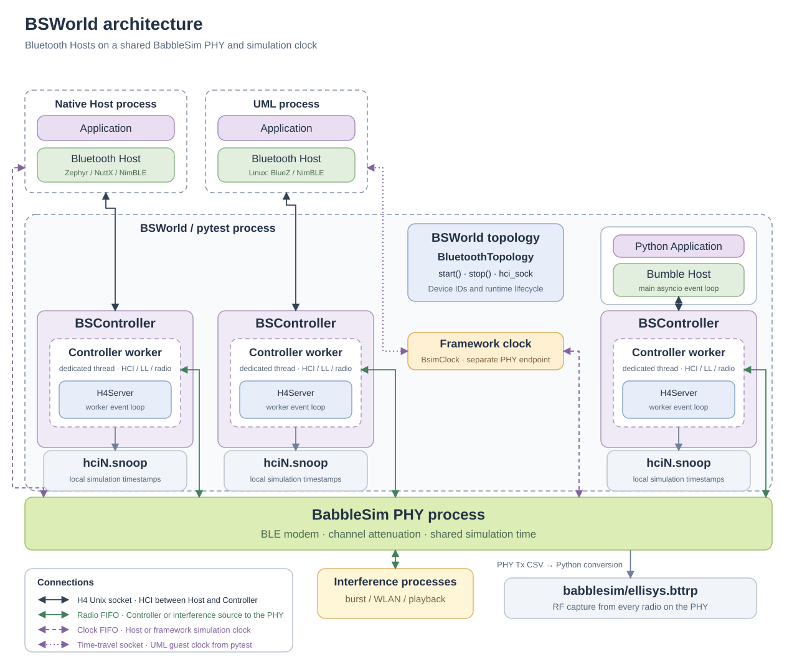

<div align="center">


[English](../../README.md) | 简体中文

[](https://github.com/XiaoMi/bsworld/actions/workflows/ci.yml) [](https://github.com/XiaoMi/bsworld/releases/latest) [](https://pypi.org/project/bscontroller/) [](../../LICENSE)

</div>

BSWorld 是一个在 Linux 上测试蓝牙 Host 和应用的确定性仿真框架。pytest 用例定义拓扑和预期行为。各 Host 通过 H4 HCI 连接 BSController，在同一个 BabbleSim 无线环境中通信。

- 直接测试上游 Host 协议栈，无需蓝牙硬件。
- 同一场景中的多台设备共享仿真时钟。独立场景可用 pytest-xdist 并行运行。
- 设置路径衰减，注入干扰或 WLAN 活动，也可以回放录制的无线信号。
- 通过应用日志、HCI BTSnoop 抓包、PHY 日志和 Ellisys 跟踪文件排查问题。

## 快速开始

BSWorld 运行于 Linux/x86_64。

### Docker

Docker 镜像包含 BabbleSim、32 位 UML 内核和 Guest 根文件系统。Host 可执行文件随根文件系统提供。安装 [Docker Engine](https://docs.docker.com/engine/install/ubuntu/) 后，在仓库根目录运行集成测试。

```sh
sudo docker pull ghcr.io/xiaomi/bsworld-linux:latest
mkdir -p .cache/docker-results
# 已发布镜像以 UID/GID 1000 运行。
sudo chown 1000:1000 .cache/docker-results
sudo docker run --rm \
  --security-opt seccomp=docker/uml-seccomp.json \
  --mount "type=bind,src=$PWD/.cache/docker-results,dst=/output" \
  ghcr.io/xiaomi/bsworld-linux:latest
```

测试结果写入 `.cache/docker-results`，包括 `pytest.xml`、进程日志、HCI 抓包和 RF 跟踪文件。测试套件、镜像版本和本地构建方式见 [Docker 使用说明](../../docker/README.zh-CN.md)。

### 本地 Linux

开发和测试需要 Python 3.12 或更高版本。在 Ubuntu 24.04 上安装以下工具。

```sh
sudo apt-get update
sudo apt-get install -y \
  bash ca-certificates curl git repo file make binutils build-essential \
  python3.12 python3.12-dev python3.12-venv python3-pip \
  gcc-multilib g++-multilib coreutils findutils grep sed
```

克隆 BSWorld 并在虚拟环境中安装。

```sh
git clone https://github.com/XiaoMi/bsworld.git
cd bsworld
export BSWORLD_ROOT="$PWD"
python3.12 -m venv .venv
source .venv/bin/activate
python -m pip install -e components/bscontroller -e '.[test]'
```

运行开发检查。

```sh
ruff check .
ruff format --check .
pytest tests/unit -q
```

#### 构建与测试

获取 `components/babblesim.xml` 固定的 BabbleSim 版本。

```sh
mkdir -p "$BSWORLD_ROOT/.cache/babblesim"
cd "$BSWORLD_ROOT/.cache/babblesim"
repo init --standalone-manifest --depth=1 -u "file://$BSWORLD_ROOT/components/babblesim.xml"
repo sync -c --no-tags
```

设置构建路径并编译 BabbleSim。

```sh
export BSIM_OUT_PATH="$PWD/build"
export BSIM_COMPONENTS_PATH="$PWD/components"
export BSIM_BUILD_FAIL_ASAP=1
make -j"$(nproc)" everything
```

在仓库根目录运行 BabbleSim 集成测试。换用新 shell 时，先激活 `.venv`，并重新导出 `BSWORLD_ROOT` 和 `BSIM_OUT_PATH`。

```sh
cd "$BSWORLD_ROOT"
pytest tests/integration/babblesim -n auto
```

本地运行 Host 集成套件需要 32 位 Guest。准备步骤见 [UML 测试环境](../../tests/integration/uml/README.zh-CN.md)。

## 支持的集成环境

各套件在 UML Guest 中运行对应的 Host，并与同一仿真无线环境中的 Bumble 对测。

| Guest 中的 Host | 测试覆盖 |
|---|---|
| [BlueZ](../../tests/integration/uml/bluez/README.zh-CN.md) | 多 Guest 广播、扫描、连接与断开 |
| [Zephyr 蓝牙 shell](../../tests/integration/uml/zephyr/README.zh-CN.md) | 广播与扫描、GATT、配对和隐私、链路更新、周期广播及同步转移 |
| [NuttX BTSak 与 NimBLE](../../tests/integration/uml/nuttx/README.zh-CN.md) | 广播、多广播端扫描、定向干扰恢复、GATT 读写与通知 |
| [Apache NimBLE Linux](../../tests/integration/uml/nimble/README.zh-CN.md) | 发现、连接 |

## 技术架构

每个 Host 通过 H4 HCI 连接自己的 BSController。Controller、pytest 时钟和配置的干扰源共用一个 BabbleSim PHY。

Bumble 运行在 pytest 事件循环中。各 UML Guest 独立运行，通过各自的 time-travel socket 从该循环获取仿真时间。同一拓扑可以同时运行多个 Guest。

<div align="center"><br><em>图 1：BSWorld 架构</em><br><br></div>

设备地址、缓冲区大小和蓝牙版本均可按 Controller 单独设置。设置方法见 [BSController 配置](controllers.md)。

用 Wireshark 或其他支持 BTSnoop 的工具打开 `hciN.snoop`，用 Ellisys 打开 `babblesim/ellisys.bttrp` 查看空口交互。完整目录结构见[日志、跟踪文件与抓包](artifacts.md)。

### 离散时间调度

| 时间基准 | 含义 |
|---|---|
| **仿真时间** | 在所有 PHY 参与者同步后推进，决定协议定时器、报文时序、RF 事件、asyncio 等待和测试超时。 |
| **墙钟时间** | 测试在主机上的实际耗时，随 CPU 负载和 Linux 调度变化。 |

拓扑启动后，`asyncio` 的等待和超时使用仿真时间。示例见[异步等待与仿真时间](writing-tests.md#异步等待与仿真时间)。

稳定复现要求二进制和输入保持一致，并控制随机源。外部网络、依赖墙钟的服务和未适配的 Host I/O 仍可能引入非确定性。

## 文档

- [编写测试和 RF 场景](writing-tests.md)
- [分配和配置 BSController](controllers.md)
- [查找日志、跟踪文件与抓包](artifacts.md)
- [运行单元测试、代码检查和覆盖率统计](development.md)
- [构建或运行 Docker 测试镜像](../../docker/README.zh-CN.md)

## 社区协作

- [贡献指南](CONTRIBUTING.md)
- [社区行为准则](CODE_OF_CONDUCT.md)
- [安全策略](SECURITY.md)

## 开源协议

BSWorld 使用 [Apache License 2.0](../../LICENSE)。第三方组件的许可证见[第三方声明](THIRD_PARTY_NOTICES.md)。
