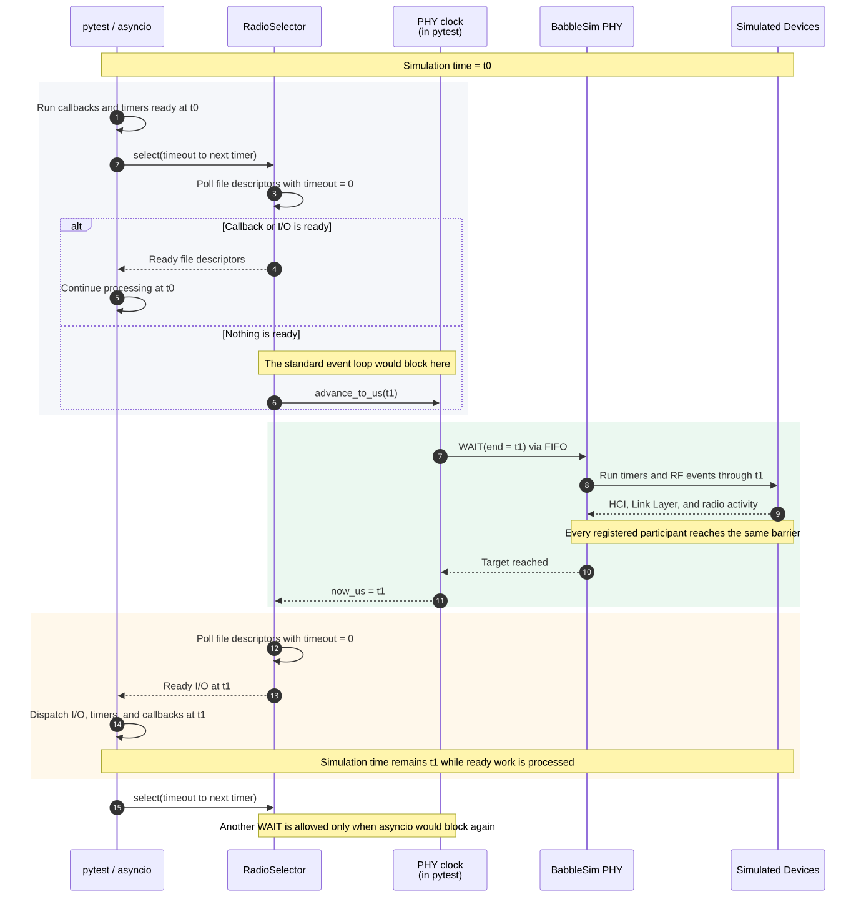

# 编写测试

[English](../writing-tests.md) | [简体中文](writing-tests.md)

仓库 [README](README.md#技术架构) 已经介绍了虚拟 Controller 和离散时间调度。本文按照测试的实际编写过程，说明如何声明拓扑、接入业务程序、使用 asyncio 执行与等待、配置 RF 场景，并验证预期的 Bluetooth LE 行为。

## 快速索引

- [测试生命周期](#测试生命周期)
- [添加 Controller](#添加-controller)
- [异步等待与仿真时间](#异步等待与仿真时间)
- [在 UML 中运行 Host](#在-uml-中运行-host)
- [向进程发送 Shell 命令](#向进程发送-shell-命令)
- [RF 条件与干扰](#rf-条件与干扰)
- [使用 pytest 描述拓扑](#使用-pytest-描述拓扑)

## 测试生命周期

`topo` fixture 为每个测试提供 `BluetoothTopology`。

1. 通过 `topo.add_controller()` 为各 Host 分配 Controller，并配置 RF 条件。
2. 调用 `await topo.start()` 启动 PHY、Controller、干扰源和仿真时钟。
3. 启动 UML Guest 并通过控制台验证行为。Bumble 等 Python Host 在测试的 asyncio event loop 中直接连接 Controller 的 HCI socket。
4. 清理阶段停止 Guest、Controller 和 PHY，保存日志与抓包。

每个测试都有独立的仿真标识、Unix socket 目录和日志目录，因此多个虚拟测试可以并行运行，不会共享 Controller 状态、RF 状态或输出文件。

## 添加 Controller

每个 Host 通过 `topo.add_controller()` 获得自己的虚拟 Controller，在 `topo.start()` 之后连接到它的 `hci_sock`：

```python
ctl = topo.add_controller(public_address="F0:F1:F2:F3:F4:01")
await topo.start()
# 将 Host 连接到 ctl.hci_sock。
```

可用参数见 [BSController 配置](controllers.md)。

## 异步等待与仿真时间

BSWorld 保留标准 asyncio 编程模型，测试无需改用专用的任务、I/O、sleep 或超时接口。pytest 使用的 `BsimEventLoop` 仍然管理 asyncio 的任务、Future、队列、Event、stream 和 socket；与普通 event loop 的区别只在于仿真启动后采用的时间来源和等待方式。

创建 `topo` fixture 后，event loop 先按照墙钟运行，用于完成测试初始化。`await topo.start()` 启动全部参与者并完成 BabbleSim 注册后，BSWorld 将 BabbleSim 时钟客户端绑定到 event loop。此后，`loop.time()` 随仿真时间推进，`asyncio.sleep()`、`asyncio.wait_for()` 和其他基于 event loop 的超时也都使用仿真时间。例如，`timeout=30` 表示最多等待 30 秒仿真时间，而不是 30 秒墙钟时间：

```python
import asyncio

await topo.start()

await dev.wait_log("ready", timeout=30)
await asyncio.sleep(0.2)
result = await asyncio.wait_for(operation(), timeout=5)
```

仿真时间只有在当前时间戳上的全部回调和 I/O 事件都处理完成后才会推进，因此测试总是先看到同一时刻调度的所有工作，时钟才继续前进。图 1 展示了这样一次推进。

<div align="center"><br><em>图 1：一次确定性的离散时间推进</em><br><br></div>

`UmlGuest.wait_log()` 建立在同一套异步等待机制之上，因此其 `timeout` 同样使用仿真时间。它按到达顺序对已经缓存和后续产生的完整日志行执行正则匹配；未收到换行符的片段不会提前参与匹配，已经扫描过的行也不会被后续调用重复检查。因此，连续的日志断言应按照预期事件顺序书写。

> [!WARNING]
> 异步测试中不能调用 `time.sleep()` 这类阻塞函数，因为它会阻塞 event loop 线程。应优先使用异步接口；不参与协议时序且无法避免的 Host 侧阻塞操作可以交给 `asyncio.to_thread()`。

## 在 UML 中运行 Host

启动拓扑前为每个 Guest 添加一个 Controller，启动后通过 `bsworld.uml.UmlGuest` 创建 Guest。Guest 使用指定的内核和只读根文件系统，Controller 的 H4 socket 接到 `/dev/ttyS0`。参数 `init` 指定 Guest 根文件系统中的路径。

```python
from bsworld.uml import UmlGuest

controller = topo.add_controller(log_subdir="uml/host")
await topo.start()

with UmlGuest(
    topo,
    controller,
    kernel=kernel,
    rootfs=rootfs,
    init="/init",
    label="host",
    log_subdir="uml/host",
    getrandom_library=seed_library,
) as guest:
    await guest.wait_log(r"^BSWORLD_UML_READY$")
    await guest.shell.run("btattach -B /dev/ttyS0 -P h4 &")
    await guest.wait_log(r"Device index 0 attached")
```

同一个测试可以启动多个 Guest，每个使用独立的名称、Controller、控制台和 time-travel socket。Guest 共享拓扑时钟，PHY 只为 Controller 分配设备 ID。内核、根文件系统和随机数种子库的准备方式见 [UML 测试环境](../../tests/integration/uml/README.zh-CN.md)。

## 向进程发送 Shell 命令

在 Guest 控制台就绪后发送命令并等待结果。

```python
await dev.shell.run("...")
await dev.wait_log(r"...", timeout=5)
```

根据平台 README 将占位符替换为具体命令及预期输出。`shell.run()` 只向标准输入写入一行命令，不等待命令执行完成；应通过 `wait_log()` 或其他可观察条件确认结果。

## RF 条件与干扰

RF 条件必须在 `await topo.start()` 之前配置；拓扑启动后，PHY 参数和参与者集合保持不变。路径衰减与干扰源作用于同一 BabbleSim PHY 上的全部虚拟 Controller。PHY 默认使用 `BLE_simple` 调制解调器，因此 RSSI、SNR 和路径衰减都会影响报文接收结果。

### 信道衰减

```python
topo.set_channel_attenuation(
    default_db=70.0,
    extra_db=0.0,
)
```

| 参数 | 默认值 | 含义 |
|---|---|---|
| `default_db` | `60.0` | 所有未被固定或时变配置覆盖的有向 `tx -> rx` 路径损耗。 |
| `extra_db` | `0.0` | 叠加到每条路径上的额外衰减。 |
| `matrix_file` | `None` | 原始 `multiatt` 矩阵文件路径，与自动生成的路径配置互斥。 |
| `static_paths` | `[]` | 各条固定路径的衰减配置。 |
| `timed_paths` | `[]` | 各条路径随时间变化的衰减曲线。 |

### 按路径配置衰减

这里的 `peripheral` 和 `central` 是已经登记到拓扑中的设备。

```python
from bsworld.interference import StaticAttenuation, TimedAttenuation

topo.set_channel_attenuation(
    default_db=50.0,
    static_paths=[
        StaticAttenuation(
            tx=peripheral,
            rx=central,
            attenuation_db=55.0,
        ),
    ],
    timed_paths=[
        TimedAttenuation(
            tx=central,
            rx=peripheral,
            times_us=[0, 10_000_000, 20_000_000],
            attenuation_db=[50.0, 80.0, 50.0],
        ),
    ],
)
```

路径具有方向性；如果两个方向需要不同的损耗，应分别配置 `tx -> rx` 和 `rx -> tx`。`TimedAttenuation` 的时间点与衰减值必须一一对应，相邻时间点之间采用线性插值。

`tx` 和 `rx` 可引用已注册的 `BSController`、`add_*_interference()` 返回的 `InterferenceRef` 或 BabbleSim 设备编号。

### 突发干扰

```python
jammer = topo.add_burst_interference(
    center_freq_mhz=2402.0,
    power_dbm=10.0,
    interf_type="CW",
    windows=[],
    rand_seed=None,
)
```

`windows=[]` 表示干扰在整个仿真期间生效；使用 `[(start_us, end_us)]` 可以限定生效窗口。返回的 `InterferenceRef` 可以作为 `StaticAttenuation` 或 `TimedAttenuation` 的 `tx`，用于设置干扰源到指定接收端的路径损耗。

### WLAN 活动模型

```python
topo.add_wlan_interference(
    channel=6,
    power_dbm=20.0,
    config_set="VideoConf",
)
```

必须使用 `channel=1..14` 或 `center_freq_mhz=<MHz>` 中的一种方式指定频点。`config_set` 选择流量模型，例如 `VoIP`、`VideoConf`、`FileDownload`、`100`、`50`、`25`、`10` 或 `5`。

### 回放干扰

```python
topo.add_playback_interference("path/to/recording")
```

传入的路径是文件名前缀。BabbleSim 要求该前缀对应的 `.Tx.csv`、`.Rx.csv`、`.RSSI.csv` 和 `.CCA.csv` 文件同时存在。

### 参数约束

BSWorld 在启动 BabbleSim 进程前校验 RF 参数：

| 类型 | 参数 | 有效范围 |
|---|---|---|
| 突发干扰 / WLAN | `center_freq_mhz` | `> 2273.0` 且 `< 2527.0` MHz。接口使用绝对频率；常用 Bluetooth LE 广播信道对应 2402、2426 和 2480 MHz。 |
| 突发干扰 / WLAN | `power_dbm` | `-128.0 .. 127.0` dBm。 |
| 突发干扰 / WLAN | `windows` | 最多 256 个窗口。每个 `(start_us, end_us)` 都必须以整数微秒表示，满足 `start_us > 0` 和 `end_us > start_us`，而且各窗口必须严格递增、互不重叠。`[]` 表示全程生效。 |
| 突发干扰 / WLAN | `rand_seed` | 无符号 32 位整数，`0 .. 4294967295`。 |
| 突发干扰 / WLAN | `interf_type` / `mod_type` | `"CW"`、`"WLAN"`、`"BLE"`、`"WN1"`、`"WN2"`、`"WN4"`、`"WN8"`、`"WN16"`、`"WN20"`、`"WN40"`、`"WN80"`。 |
| WLAN | `channel` | Wi-Fi 信道 `1 .. 14`；信道 14 对应 2484 MHz。 |
| WLAN | `config_set` | `"VoIP"`、`"VideoConf"`、`"FileDownload"`、`"FileDownload_24M"`、`"FileDownload_12M"`、`"FileDownload_6M"`、`"100"`、`"100_24M"`、`"100_12M"`、`"100_6M"`、`"50"`、`"50_24M"`、`"50_12M"`、`"50_6M"`、`"25"`、`"25_24M"`、`"25_12M"`、`"25_6M"`、`"10"`、`"10_24M"`、`"10_12M"`、`"10_6M"`、`"5"`。 |
| 信道 | `default_db` / `extra_db` | `-100.0 .. 100.0` dB。 |
| 信道 | `StaticAttenuation.attenuation_db` | 任意有限的 dB 值。该值会写入矩阵文件，作为指定路径的衰减值。 |
| 信道 | `TimedAttenuation.times_us` | 以整数微秒表示，必须 `>= 0`、严格递增，并且至少包含两个时间点。 |
| 信道 | `TimedAttenuation.attenuation_db` | 与 `times_us` 等长的有限 dB 值序列，相邻时间点之间采用线性插值。 |

## 使用 pytest 描述拓扑

[BlueZ 多 Guest 用例](../../tests/integration/uml/bluez/test_uml_bluez.py)在同一拓扑中启动两台 Guest，由 Bumble 接收二者的广播。[NuttX 干扰用例](../../tests/integration/uml/nuttx/test_btsak.py)通过各 Guest 的 Controller 配置定向衰减，并验证干扰结束后的恢复。
